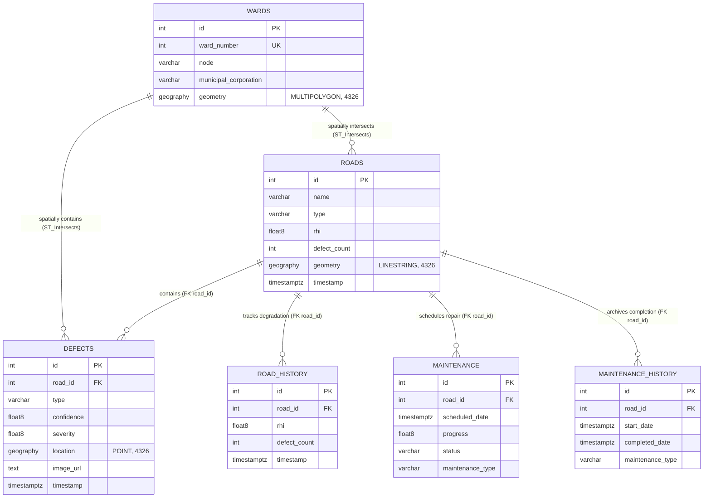
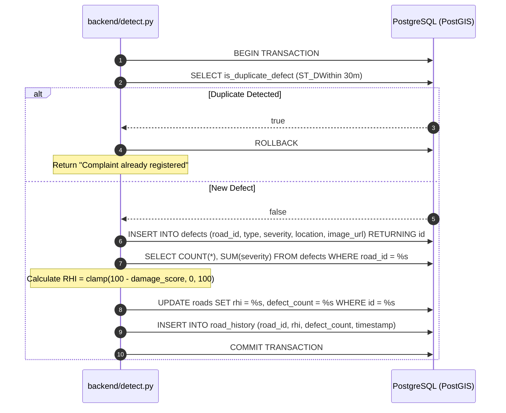
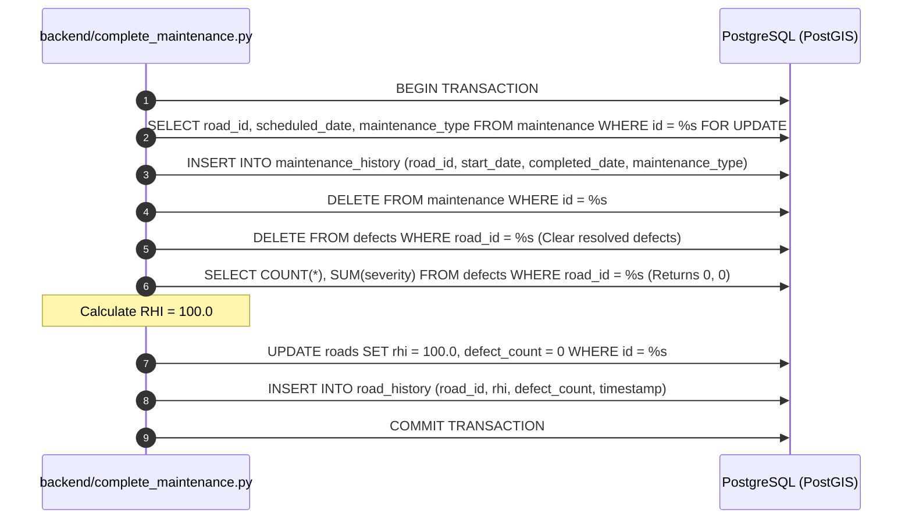

# RoadSense AI — Database Schema & Spatial Architecture (`db.MD`)

> **Database Engine:** PostgreSQL 15+ with PostGIS Spatial Extension  
> **Coordinate Reference System (CRS):** WGS 84 / World Geodetic System 1984 (`SRID 4326`)  
> **Spatial Data Type:** Native PostGIS `GEOGRAPHY` (spherical calculations in meters)  
> **Target Jurisdiction:** Navi Mumbai Municipal Corporation (NMMC) Roadway Infrastructure

---

## 1. Overview & Spatial Architecture

The RoadSense AI database is built on **PostgreSQL** paired with the **PostGIS** spatial extension. It provides native geospatial storage, spatial joins, spherical distance calculations, and fast bounding-box queries for urban pavement management.

### Key Architectural Characteristics
- **Spherical Geography (`SRID 4326`):** All spatial columns (`location`, `geometry`) utilize PostGIS `geography` rather than planar `geometry`. This enables high-precision great-circle distance computations in meters (e.g. `ST_Distance`, `ST_DWithin`) without manual planar projection distortion.
- **Spatial Indexing (`GIST`):** Generalized Search Tree (`GIST`) indexes are placed on all spatial geography columns, ensuring sub-millisecond execution for spatial joins (`ST_Intersects`), radial deduplication (`ST_DWithin`), and K-Nearest Neighbors (KNN `<->`) nearest-road snapping.
- **Relational Integrity & Cascades:** Roads serve as the central anchor entity. Deleting a road cascades deletions across defects, historical RHI records, active maintenance tasks, and maintenance history.
- **Auditability & Temporal Tracking:** All tables feature timestamping (`TIMESTAMPTZ`). The `road_history` table acts as an append-only time-series ledger recording every change in Road Health Index (RHI) and defect count.

---

## 2. Entity-Relationship Diagram (ERD)



---

## 3. Complete Production DDL (Executable SQL)

Execute the following script in PostgreSQL or the Supabase SQL Editor to provision the complete database schema, constraints, and indexes:

```sql
-- ============================================================================
-- 1. EXTENSIONS
-- ============================================================================
CREATE EXTENSION IF NOT EXISTS postgis;

-- ============================================================================
-- 2. TABLE DEFINITIONS
-- ============================================================================

-- Table: wards
CREATE TABLE IF NOT EXISTS wards (
    id SERIAL PRIMARY KEY,
    ward_number INTEGER NOT NULL UNIQUE,
    node VARCHAR(100),
    municipal_corporation VARCHAR(50) DEFAULT 'NMMC',
    geometry GEOGRAPHY(MULTIPOLYGON, 4326) NOT NULL
);

-- Table: roads
CREATE TABLE IF NOT EXISTS roads (
    id SERIAL PRIMARY KEY,
    name VARCHAR(255) NOT NULL,
    type VARCHAR(100) DEFAULT 'unclassified',
    rhi DOUBLE PRECISION DEFAULT 100.0 CHECK (rhi >= 0.0 AND rhi <= 100.0),
    defect_count INTEGER DEFAULT 0 CHECK (defect_count >= 0),
    geometry GEOGRAPHY(LINESTRING, 4326) NOT NULL,
    timestamp TIMESTAMPTZ DEFAULT NOW()
);

-- Table: defects
CREATE TABLE IF NOT EXISTS defects (
    id SERIAL PRIMARY KEY,
    road_id INTEGER NOT NULL REFERENCES roads(id) ON DELETE CASCADE,
    type VARCHAR(50) NOT NULL,
    confidence DOUBLE PRECISION NOT NULL CHECK (confidence >= 0.0 AND confidence <= 1.0),
    severity DOUBLE PRECISION NOT NULL CHECK (severity >= 0.0 AND severity <= 100.0),
    location GEOGRAPHY(POINT, 4326) NOT NULL,
    image_url TEXT NOT NULL,
    timestamp TIMESTAMPTZ DEFAULT NOW()
);

-- Table: road_history
CREATE TABLE IF NOT EXISTS road_history (
    id SERIAL PRIMARY KEY,
    road_id INTEGER NOT NULL REFERENCES roads(id) ON DELETE CASCADE,
    rhi DOUBLE PRECISION NOT NULL CHECK (rhi >= 0.0 AND rhi <= 100.0),
    defect_count INTEGER NOT NULL CHECK (defect_count >= 0),
    timestamp TIMESTAMPTZ DEFAULT NOW()
);

-- Table: maintenance
CREATE TABLE IF NOT EXISTS maintenance (
    id SERIAL PRIMARY KEY,
    road_id INTEGER NOT NULL REFERENCES roads(id) ON DELETE CASCADE,
    scheduled_date TIMESTAMPTZ NOT NULL,
    progress DOUBLE PRECISION DEFAULT 0.0 CHECK (progress >= 0.0 AND progress <= 100.0),
    status VARCHAR(50) DEFAULT 'scheduled' CHECK (status IN ('scheduled', 'in_progress', 'completed')),
    maintenance_type VARCHAR(100) NOT NULL
);

-- Table: maintenance_history
CREATE TABLE IF NOT EXISTS maintenance_history (
    id SERIAL PRIMARY KEY,
    road_id INTEGER NOT NULL REFERENCES roads(id) ON DELETE CASCADE,
    start_date TIMESTAMPTZ NOT NULL,
    completed_date TIMESTAMPTZ DEFAULT NOW(),
    maintenance_type VARCHAR(100) NOT NULL
);

-- ============================================================================
-- 3. INDEXES (SPATIAL & PERFORMANCE)
-- ============================================================================

-- Spatial GIST Indexes
CREATE INDEX IF NOT EXISTS idx_wards_geometry ON wards USING GIST(geometry);
CREATE INDEX IF NOT EXISTS idx_roads_geometry ON roads USING GIST(geometry);
CREATE INDEX IF NOT EXISTS idx_defects_location ON defects USING GIST(location);

-- B-Tree Indexes for Foreign Keys & Filter Performance
CREATE INDEX IF NOT EXISTS idx_defects_road_id ON defects(road_id);
CREATE INDEX IF NOT EXISTS idx_defects_type ON defects(type);
CREATE INDEX IF NOT EXISTS idx_defects_timestamp ON defects(timestamp DESC);

CREATE INDEX IF NOT EXISTS idx_roads_rhi ON roads(rhi);
CREATE INDEX IF NOT EXISTS idx_roads_defect_count ON roads(defect_count);

CREATE INDEX IF NOT EXISTS idx_road_history_road_id_time ON road_history(road_id, timestamp DESC);

CREATE INDEX IF NOT EXISTS idx_maintenance_road_id ON maintenance(road_id);
CREATE INDEX IF NOT EXISTS idx_maintenance_status ON maintenance(status);
CREATE INDEX IF NOT EXISTS idx_maintenance_scheduled_date ON maintenance(scheduled_date ASC);

CREATE INDEX IF NOT EXISTS idx_maint_history_road_id ON maintenance_history(road_id);
CREATE INDEX IF NOT EXISTS idx_maint_history_completed_date ON maintenance_history(completed_date DESC);
```

---

## 4. Detailed Table Specifications

### 4.1 Table: `wards`
Stores official municipal boundary polygons and administrative nodes across Navi Mumbai.

| Column Name | PostgreSQL Data Type | Nullable | Default | Description & Application Usage |
|---|---|:---:|---|---|
| `id` | `SERIAL` (Integer) | **No** | Auto-increment | Primary key identifying the administrative ward record. |
| `ward_number` | `INTEGER` | **No** | None | Official municipal corporation ward number (e.g. Ward 1, 14, 42). Unique. |
| `node` | `VARCHAR(100)` | Yes | `NULL` | Urban node / neighborhood identity (e.g. Nerul, Vashi, Belapur, Kharghar, Airoli). |
| `municipal_corporation` | `VARCHAR(50)` | Yes | `'NMMC'` | Managing municipal agency (Navi Mumbai Municipal Corporation). |
| `geometry` | `GEOGRAPHY(MULTIPOLYGON, 4326)` | **No** | None | PostGIS spatial boundary polygon. Used in spatial joins with roads and defects. |

**Application Usage in Backend:**
- Populated via `python -m backend.import_wards` from GeoJSON files.
- Queried by `GET /wards` to deliver vector boundaries and dynamic ward defect counts.
- Joined in `GET /wards/{ward_number}/roads`, `GET /wards/{ward_number}/defects`, and `GET /wards/{ward_number}/maintenance`.

---

### 4.2 Table: `roads`
Stores official road network centerlines, classification, and dynamic health status.

| Column Name | PostgreSQL Data Type | Nullable | Default | Description & Application Usage |
|---|---|:---:|---|---|
| `id` | `SERIAL` (Integer) | **No** | Auto-increment | Primary key identifying the road segment. |
| `name` | `VARCHAR(255)` | **No** | None | Road name or highway designation (e.g. "Palm Beach Road", "Thane-Belapur Road", "Unnamed Road"). |
| `type` | `VARCHAR(100)` | Yes | `'unclassified'` | Highway classification from OpenStreetMap (e.g. `primary`, `secondary`, `tertiary`, `residential`). |
| `rhi` | `DOUBLE PRECISION` | Yes | `100.0` | **Road Health Index (0.0 to 100.0).** Recalculated dynamically upon defect detection or repair completion. |
| `defect_count` | `INTEGER` | Yes | `0` | Cached total count of active, unresolved defects on this road segment. |
| `geometry` | `GEOGRAPHY(LINESTRING, 4326)` | **No** | None | PostGIS spatial centerline polyline coordinates. |
| `timestamp` | `TIMESTAMPTZ` | Yes | `NOW()` | Timestamp indicating when the road was ingested or last updated. |

**Application Usage in Backend:**
- Ingested via `python -m backend.import_roads` using OpenStreetMap Overpass API highway queries.
- Queried by `backend/find_nearest.py` using PostGIS KNN `<->` spatial operator for nearest road snapping.
- Queried by `backend/dashboard.py` via `ST_MakeEnvelope` bounding-box intersections for zoomed map viewports.
- Updated by `backend/calculate_rhi.py` during detection or repair completion transactions.

---

### 4.3 Table: `defects`
Stores localized distress instances detected from dashcam image frames.

| Column Name | PostgreSQL Data Type | Nullable | Default | Description & Application Usage |
|---|---|:---:|---|---|
| `id` | `SERIAL` (Integer) | **No** | Auto-increment | Primary key for the defect entity. |
| `road_id` | `INTEGER` | **No** | None | Foreign key referencing `roads(id)`. Cascades on road deletion. |
| `type` | `VARCHAR(50)` | **No** | None | Standardized damage class (`D00`, `D10`, `D20`, `D40`, `D44`). |
| `confidence` | `DOUBLE PRECISION` | **No** | None | YOLOv8 model prediction probability bounded in $[0.0, 1.0]$. |
| `severity` | `DOUBLE PRECISION` | **No** | None | Multi-factor visual distress score bounded in $[0.0, 100.0]$ from `backend/severity.py`. |
| `location` | `GEOGRAPHY(POINT, 4326)` | **No** | None | Exact spatial coordinate (Longitude, Latitude) of the defect. |
| `image_url` | `TEXT` | **No** | None | Public Supabase Storage CDN URL displaying bounding-box annotations. |
| `timestamp` | `TIMESTAMPTZ` | Yes | `NOW()` | Capture timestamp recorded by the IoT GPS module or detection endpoint. |

**Application Usage in Backend:**
- Checked for duplicates in `backend/check_duplicate.py` using `ST_DWithin` with a 30m radius.
- Inserted by `backend/detect.py` during detection processing.
- Aggregated by `backend/calculate_rhi.py` to update road health.
- Deleted upon work order completion in `backend/complete_maintenance.py`.

---

### 4.4 Table: `road_history`
Append-only time-series ledger capturing Road Health Index (RHI) trajectory over time.

| Column Name | PostgreSQL Data Type | Nullable | Default | Description & Application Usage |
|---|---|:---:|---|---|
| `id` | `SERIAL` (Integer) | **No** | Auto-increment | Primary key of the history audit entry. |
| `road_id` | `INTEGER` | **No** | None | Foreign key referencing `roads(id)`. Cascades on road deletion. |
| `rhi` | `DOUBLE PRECISION` | **No** | None | Road Health Index at this milestone ($0.0$ to $100.0$). |
| `defect_count` | `INTEGER` | **No** | None | Active defect count at this milestone. |
| `timestamp` | `TIMESTAMPTZ` | Yes | `NOW()` | Timestamp when the RHI change was committed. |

**Application Usage in Backend:**
- Inserted by `backend/road_history.py` inside `save_rhi_history()` whenever `calculate_rhi()` updates a road.
- Used by the predictive maintenance forecasting engine to calculate deterioration velocity ($\frac{d\text{RHI}}{dt}$) and time-to-failure curves.
- Powers the 12-month historical degradation graphs rendered on `/roads/$id`.

---

### 4.5 Table: `maintenance`
Stores active, in-progress, and scheduled road repair work orders.

| Column Name | PostgreSQL Data Type | Nullable | Default | Description & Application Usage |
|---|---|:---:|---|---|
| `id` | `SERIAL` (Integer) | **No** | Auto-increment | Primary key of the maintenance work order. |
| `road_id` | `INTEGER` | **No** | None | Foreign key referencing `roads(id)`. Cascades on road deletion. |
| `scheduled_date` | `TIMESTAMPTZ` | **No** | None | Scheduled target execution date for the repair. |
| `progress` | `DOUBLE PRECISION` | Yes | `0.0` | Completion progress percentage ($0.0\%$ to $100.0\%$). |
| `status` | `VARCHAR(50)` | Yes | `'scheduled'` | Current lifecycle status: `'scheduled'`, `'in_progress'`, or `'completed'`. |
| `maintenance_type` | `VARCHAR(100)` | **No** | None | Technical treatment: *Pothole patching, Crack sealing, Resurfacing, Lane re-marking, Micro-surfacing, Full reconstruction*. |

**Application Usage in Backend:**
- Inserted via `POST /maintenance/schedule` in `backend/schedule_maintenance.py`.
- Updated via `PUT /maintenance/{maintenance_id}` in `backend/update_maintenance.py`.
- Queried by ward via `GET /wards/{ward_number}/maintenance` in `backend/maintenance_records.py`.
- Row-locked (`FOR UPDATE`) and deleted upon completion in `backend/complete_maintenance.py`.

---

### 4.6 Table: `maintenance_history`
Permanent archive of completed and verified road repair work orders.

| Column Name | PostgreSQL Data Type | Nullable | Default | Description & Application Usage |
|---|---|:---:|---|---|
| `id` | `SERIAL` (Integer) | **No** | Auto-increment | Primary key of the completed maintenance archive entry. |
| `road_id` | `INTEGER` | **No** | None | Foreign key referencing `roads(id)`. Cascades on road deletion. |
| `start_date` | `TIMESTAMPTZ` | **No** | None | Original scheduled or commencement date from the active record. |
| `completed_date` | `TIMESTAMPTZ` | Yes | `NOW()` | Exact timestamp when completion was verified and committed. |
| `maintenance_type` | `VARCHAR(100)` | **No** | None | Technical repair methodology executed on the corridor. |

**Application Usage in Backend:**
- Populated exclusively by `POST /maintenance/{maintenance_id}/complete` in `backend/complete_maintenance.py`.
- Queried by `GET /wards/{ward_number}/maintenance/history` in `backend/maintenance_records.py`.

---

## 5. PostGIS Spatial Operations Reference

The following table documents the exact PostGIS spatial operators and functions utilized in the RoadSense AI codebase:

| Function / Operator | Source Module | SQL Usage Pattern | Purpose & Rationale |
|---|---|---|---|
| `ST_Intersects` | `ward_roads.py`<br>`ward_defects.py`<br>`maintenance_records.py` | `ON ST_Intersects(r.geometry, w.geometry)` | Performs spatial joins between line/point features and ward boundary polygons. |
| `<->` (KNN Operator) | `find_nearest.py` | `ORDER BY geometry <-> ST_SetSRID(ST_MakePoint(%s, %s), 4326)::geography LIMIT 1` | K-Nearest Neighbors index-driven distance search to find the closest road centerline instantly. |
| `ST_Distance` | `find_nearest.py` | `ST_Distance(geometry, ST_SetSRID(ST_MakePoint(%s, %s), 4326)::geography)` | Computes exact geodesic distance in meters from GPS coordinates to candidate road polyline. |
| `ST_DWithin` | `check_duplicate.py` | `ST_DWithin(location, ST_SetSRID(ST_MakePoint(%s, %s), 4326)::geography, 30.0)` | Radial boundary check enforcing 30-meter spatial deduplication for identical distress classes. |
| `ST_MakeEnvelope` | `dashboard.py` | `ST_Intersects(r.geometry, ST_MakeEnvelope(%s, %s, %s, %s, 4326)::geography)` | Filters road vectors intersecting the dynamic viewport bounding box on the GIS map. |
| `ST_MakePoint` | `detect.py`<br>`check_duplicate.py` | `ST_SetSRID(ST_MakePoint(lng, lat), 4326)::geography` | Constructs a spatial Point geometry from longitude and latitude decimal values. |
| `ST_AsGeoJSON` | `ward_roads.py`<br>`find_nearest.py`<br>`dashboard.py` | `ST_AsGeoJSON(geometry) AS geometry` | Serializes PostGIS binary geometries into standardized GeoJSON strings for frontend rendering. |
| `ST_GeomFromGeoJSON` | `import_wards.py` | `ST_GeomFromGeoJSON(%s)::geography` | Parses GeoJSON MultiPolygon text into PostGIS spatial geography during ward boundary ingestion. |
| `ST_GeogFromText` | `import_roads.py` | `ST_GeogFromText('LINESTRING(...)')` | Parses Well-Known Text (WKT) highway strings into PostGIS spatial geography during road network imports. |
| `ST_X` / `ST_Y` | `ward_defects.py`<br>`dashboard.py` | `ST_Y(location::geometry) AS lat, ST_X(location::geometry) AS lng` | Extracts scalar decimal latitude and longitude coordinates from Point geometries. |

---

## 6. End-to-End Database Transaction Workflows

### 6.1 Defect Ingestion & Health Update Transaction
Executed atomically inside `backend/detect.py`:



### 6.2 Maintenance Work Order Completion Transaction
Executed atomically inside `backend/complete_maintenance.py`:



---

## 7. Migration & Local Provisioning Instructions

### Step 1: Install PostgreSQL with PostGIS
Ensure your local PostgreSQL instance or remote Supabase database has PostGIS installed:
```bash
# Ubuntu / Debian
sudo apt-get install postgresql-15 postgresql-15-postgis-3

# macOS via Homebrew
brew install postgresql@15 postgis
```

### Step 2: Initialize Database and Enable PostGIS
```sql
CREATE DATABASE roadsense_db;
\c roadsense_db;
CREATE EXTENSION IF NOT EXISTS postgis;
```

### Step 3: Run the Schema DDL
Execute the complete DDL provided in [Section 3](#3-complete-production-ddl-executable-sql) using `psql` or Supabase SQL Editor:
```bash
psql -U postgres -d roadsense_db -f db.MD
# Or copy and run the SQL block directly in the query editor
```

### Step 4: Seed Ward Boundaries and Roads
From the project root:
```bash
# 1. Populate wards from GeoJSON
python -m backend.import_wards

# 2. Ingest OpenStreetMap road network for Navi Mumbai
python -m backend.import_roads
```
