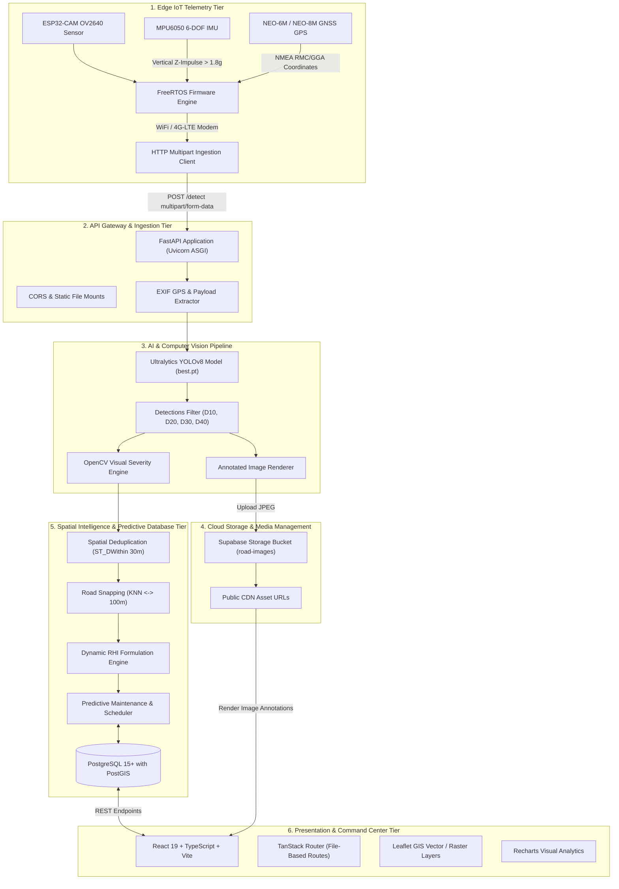
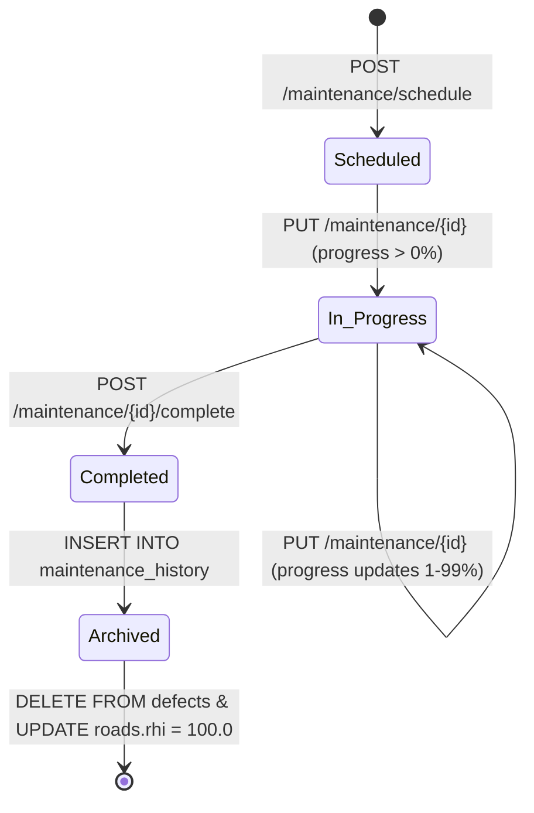

# RoadSense AI — Comprehensive Technical & Architectural Specifications

> **System Classification:** Intelligent Transportation Systems (ITS) & AI-Powered Pavement Distress Management  
> **Target Jurisdiction:** Navi Mumbai Municipal Corporation (NMMC) Urban Road Network  
> **Core Capabilities:** Edge IoT Dashcam Telemetry, YOLOv8 Deep Learning Defect Detection, Geospatial PostGIS Analysis, Visual Severity Scoring, Road Health Index (RHI) Quantification, Predictive Maintenance Scheduling, and Enterprise GIS Web Portal.

---

## 1. System Overview & Executive Summary

**RoadSense AI** is an enterprise-grade, end-to-end cyber-physical road condition monitoring, distress detection, and predictive infrastructure management platform. The system continuously automates the inspection lifecycle of urban roadway networks:

1. **Edge Acquisition:** A vehicle-mounted IoT dashcam module (ESP32-CAM + 6-DOF IMU + GNSS GPS) captures high-resolution road pavement imagery paired with synchronized spatio-temporal telemetry and vibration impulse data.
2. **Computer Vision Inference:** An Ultralytics YOLOv8 deep learning model classifies and localizes surface distresses (longitudinal cracks, transverse cracks, alligator fatigue cracking, potholes, and faded road markings) with sub-second latency.
3. **Multi-Factor Severity Scoring:** An advanced computer vision algorithm evaluates bounding box footprint, aspect ratio geometry, local grayscale contrast, and image-gradient edge density to assign a visual distress score ($0–100$) to each detected defect. For IoT captures with valid IMU vibration data, the final score also incorporates measured dynamic acceleration.
4. **Geospatial Processing & Deduplication:** PostGIS spatial algorithms snap distress coordinates to the nearest official road centerline via K-Nearest Neighbors (KNN) within a 100-meter threshold and execute a 30-meter spatial deduplication radius to prevent redundant citizen or sensor reports.
5. **Road Health Index (RHI) Quantification:** Continuous mathematical degradation modeling calculates an aggregated RHI score ($0–100$) for every road corridor and records every transition into an append-only audit trail (`road_history`).
6. **Predictive Maintenance & Intelligent Scheduling:** Statistical degradation forecasting and condition-based thresholding predict pavement failure windows, automatically generate prioritized maintenance work orders, recommend optimal repair methods, and manage the full lifecycle from scheduling to completion and health restoration.
7. **Spatial Decision Support:** A high-performance React 19 / TanStack GIS dashboard provides civil engineers and municipal administrators with dynamic Leaflet cartography, real-time KPI metrics, temporal inspection comparisons, and ward-level distress distribution analytics.

---

## 2. High-Level System Architecture

The RoadSense AI architecture is organized into six interconnected architectural tiers:



---

## 3. Edge IoT Dashcam Module (ESP32-CAM + IMU + GPS)

The road inspection vehicle is equipped with a custom low-cost, high-reliability Edge IoT dashcam module mounted behind the vehicle's rearview mirror, oriented perpendicular to the road surface at a $45^\circ$ downward inclination.

```
       +-------------------------------------------------------+
       |             ROADSENSE AI EDGE IOT MODULE              |
       |                                                       |
       |  +----------------+  I2C   +-----------------------+  |
       |  |  MPU6050 IMU   |------->|                       |  |
       |  | (Accel + Gyro) |        |                       |  |
       |  +----------------+        |   ESP32-CAM MCU       |  |
       |                            |   Dual-Core 240MHz    |  |
       |  +----------------+  UART  |   520KB SRAM + 4MB    |  |
       |  |  NEO-6M GPS    |------->|   External PSRAM      |  |
       |  | (Ceramic Ant.) |        |                       |  |
       |  +----------------+        |                       |  |
       |                            |                       |  |
       |  +----------------+  DVP   |                       |  |
       |  |  OV2640 Camera |------->|                       |  |
       |  |  (2MP / SVGA)  |        +-----------+-----------+  |
       |  +----------------+                    |              |
       |                         SPI / SDIO     |  WiFi / 4G   |
       |                             v          v              |
       |                      +------------+  +--------------+ |
       |                      | MicroSD HC |  | SIM7600 4G   | |
       |                      | (Fail-Safe)|  | LTE Modem    | |
       |                      +------------+  +--------------+ |
       +-------------------------------------------------------+
```

### 3.1 Hardware Specifications

| Component | Hardware Model | Interface | Operational Parameters & Purpose |
|---|---|---|---|
| **Microcontroller** | ESP32-WROVER / ESP32-S3 | Dual-Core 32-bit Xtensa LX6 @ 240MHz | 520 KB internal SRAM, 4 MB external PSRAM for high-resolution image buffering and FreeRTOS task scheduling. |
| **Camera Sensor** | OmniVision OV2640 (2 Megapixel) | DVP 8-bit parallel interface | Captures pavement frames in SVGA ($800\times600$) or HD ($1280\times720$) resolution with on-chip JPEG hardware compression. |
| **Inertial Measurement Unit (IMU)** | MPU6050 6-DOF Sensor | $\text{I}^2\text{C}$ bus (Pins GPIO 13 / 14) | Tri-axial accelerometer ($\pm 8g$ range) and tri-axial gyroscope ($\pm 1000^\circ/\text{s}$). Monitors vertical $Z$-axis vibration shock profiles. |
| **GNSS Positioning Unit** | u-blox NEO-6M / NEO-8M | Hardware UART (GPIO 1 / 3 or software serial) | 10 Hz refresh rate, active ceramic patch antenna, parses NMEA-0183 sentences (`$GPGGA`, `$GPRMC`) for latitude, longitude, altitude, and ground speed. |
| **Local Storage Buffer** | MicroSD Card Slot (FAT32) | 1-bit / 4-bit SDIO / SPI | Buffers image frames and JSON telemetry during cellular blackout zones to guarantee zero data loss. |
| **Connectivity** | SIM7600 4G LTE Modem / Vehicle Hotspot | UART / 802.11 b/g/n Wi-Fi | Transmits HTTP multipart payloads directly to the backend `POST /detect` API endpoint. |

### 3.2 Firmware & Multi-Threaded Execution (FreeRTOS)

The intended ESP32 firmware executes a multi-tasking FreeRTOS pipeline split across two hardware cores:

- **Core 0 (Telemetry & Ingestion Engine):**
  - **GNSS Parser Task:** Continuously extracts decimal coordinates, timestamp, and satellite lock status.
  - **Network Transmission Task:** Monitors cellular signal strength, serializes HTTP multipart POST requests, and flushes buffered SD card frames upon network reconnection.
- **Core 1 (Sensing & Trigger Decision Engine):**
  - **IMU Shock Detection Task ($200\text{ Hz}$):** Computes normalized vertical acceleration $a_z$. If $|a_z - 1.0g| > 0.8g$ (total vertical shock $> 1.8g$), a high-priority "Impact Anomaly Event" is triggered.
  - **Camera Capture Task:** Coordinates image acquisition using dual trigger logic:
    1. *Distance/Velocity Trigger:* When vehicle speed $> 15\text{ km/h}$, an image is captured every 10 meters.
    2. *Vibration Anomaly Trigger:* Triggered instantly upon an IMU $Z$-shock event, ensuring severe potholes are captured at the moment of vehicle traversal.
  - **EXIF Metadata Injector:** Synthesizes standard EXIF GPS tags (`GPSLatitude`, `GPSLongitude`, `GPSAltitude`, `GPSTimeStamp`) directly into the JPEG file header before transmission.

### 3.3 Network Payload Format

The implemented receiver accepts a `multipart/form-data` request with:
- **File field (`file`):** JPEG image from the camera (maximum 8 MiB).
- **Form field (`metadata`):** JSON object containing `sensor_source`, `device_uptime_ms`, `gps`, and `imu` fields. GPS data includes fix validity, latitude/longitude, speed, and location age. IMU data includes validity, sampling-window details, dynamic acceleration magnitudes, per-axis acceleration statistics, and per-axis gyroscope statistics.
- **Optional query parameters (`lat`, `lng`):** Coordinate fallback when coordinates are missing from the metadata.

The receiver is implemented as a separate FastAPI application in `backend/iot.py`. It accepts uploads at `POST /detect` and `POST /iot/ingest`; it is not mounted in the main application in `backend/main.py`. The receiver validates JPEG uploads and telemetry, then passes each image through the shared detection pipeline. The most recent 20 records, original images, and available inference images are held in memory and are cleared on process restart. Captures are serialized: after inference the receiver waits for the dashboard to acknowledge that the annotated image was displayed before accepting another capture.

The Streamlit dashboard in `backend/iot_dashboard.py` polls the receiver for recent records and status, and displays captured and annotated images, GPS, IMU readings, and detected defects. Set `IOT_API_URL` if the receiver is not at its default URL (`http://127.0.0.1:8000`).

### 3.4 IoT Receiver Endpoints

| Method | Endpoint | Purpose |
|---|---|---|
| `POST` | `/detect`, `/iot/ingest` | Receive a JPEG and telemetry, run the shared inference and defect pipeline, and return the capture record and detection result. |
| `GET` | `/iot/records` | Return recent in-memory capture and telemetry records. |
| `GET` | `/iot/status` | Report whether a capture is processing or awaiting display acknowledgement. |
| `POST` | `/iot/ack/{record_id}` | Acknowledge the displayed inference image and allow the next capture. |
| `GET` | `/iot/images/{record_id}` | Retrieve a recent original JPEG from memory. |
| `GET` | `/iot/inference-images/{record_id}` | Retrieve a recent annotated inference image from memory. |
| `GET` | `/`, `/health` | Receiver identity and health status. |

---

## 4. Computer Vision & Pavement Distress Pipeline

The AI inference subsystem operates on pre-trained and fine-tuned YOLOv8 convolutional neural network weights situated at `ai/models/best.pt`.

```
Raw Image Upload (uploads/...)
           |
           v
  EXIF GPS Extraction (PIL)
           |
           v
  YOLOv8 Inference (Ultralytics)
  [Input: 640x640, Confidence Threshold >= 0.25]
           |
           v
  Class Filtering & Normalization
  [Allowed: D00, D10, D20, D40, D44]
           |
           v
  Computer Vision Visual Severity Engine (OpenCV)
  - Footprint ratio (sqrt scaling)
  - Aspect ratio / elongation (Crack vs Pothole)
  - Crop Contrast (std dev)
  - Edge density (Sobel gradient diffs)
           |
           v
  Annotation Renderer & Supabase CDN Upload
           |
           v
  Spatial Snapping & Deduplication (PostGIS)
```

### 4.1 Distress Classification Standard (JRA / RDD2022)

The system aligns with the internationally recognized Road Damage Dataset (RDD) and Japan Road Association (JRA 2013) damage criteria:

| Class Code | Pavement Distress Name | Description & Visual Characteristics | Structural Impact & Severity Weight |
|---|---|---|---|
| **`D40`** | **Pothole / Rutting** | Bowl-shaped cavities, deep structural depressions, or wheel-path rutting where asphalt has broken away. | **Weight: 1.00 (Critical)** — Severe vehicle hazard, wheel damage, immediate water ingress catalyst. |
| **`D10`** | **Alligator Crack / Equal-Interval Crack** | Interconnected polygon fatigue cracking resembling reptile skin, typically caused by load-related base failure. | **Weight: 0.85 (High)** — Indicates structural fatigue of base/sub-base layers; rapid moisture penetration. |
| **`D00`** | **Longitudinal Crack** | Linear cracks running parallel to the pavement centerline, often along paving joints or lane boundaries. | **Weight: 0.50 (Moderate)** — Thermal shrinkage or reflection cracking; requires crack sealing before propagation. |
| **`D20`** | **Transverse Crack** | Linear cracks extending perpendicular to the roadway centerline, caused by temperature cycles or shrinkage. | **Weight: 0.45 (Moderate)** — Compromises ride quality and permits water percolation into base course. |
| **`D44`** | **Faded Road Marking** | Deterioration, wear, or obliteration of lane dividers, pedestrian crossings, or directional arrows. | **Weight: 0.35 (Low)** — Visual navigation and safety issue rather than structural pavement degradation. |

### 4.2 Multi-Factor Computer Vision Severity Engine

Unlike naive systems that equate model confidence with damage severity, RoadSense AI employs a rigorous multi-factor visual algorithm implemented in `backend/severity.py`:

```python
# Composite Evidence Formulation
evidence = (
    confidence * 0.35 +
    footprint  * 0.20 +
    shape      * 0.15 +
    visual     * 0.30
)

# Total Severity Score
severity_score = class_weight * evidence * 100
```

Where:
1. **Model Confidence ($35\%$):** Bounded YOLO detection probability $\in [0.0, 1.0]$.
2. **Footprint Ratio ($20\%$):** Evaluates bounding box area relative to the full image frame:
   $$\text{area\_ratio} = \left(\frac{x_2 - x_1}{W}\right) \times \left(\frac{y_2 - y_1}{H}\right)$$
   $$\text{footprint} = \sqrt{\min\left(\frac{\text{area\_ratio}}{0.25}, 1.0\right)}$$
   *Note:* The square root curve prevents large defects from saturating disproportionately while amplifying moderate defects.
3. **Morphological Shape Factor ($15\%$):** Evaluates aspect ratio $\text{AR} = \max(w, h) / \min(w, h)$:
   - *For Cracks (`D00`, `D10`, `D20`):* Rewards high elongation ($\text{elongation} = \min((\text{AR} - 1) / 7.0, 1.0)$).
   - *For Potholes (`D40`):* Rewards compact, circular, or square geometry ($\text{compactness} = \min(1.0 / \text{AR}, 1.0)$).
4. **Visual Texture & Contrast Analysis ($30\%$):** OpenCV crops the bounding box region and computes:
   - *Local Grayscale Contrast:* Standard deviation of pixels normalized by $\sigma / 64.0$.
   - *Edge Density:* Fraction of neighboring-pixel grayscale differences greater than 20, measuring local texture and boundaries.
   $$\text{visual} = 0.5 \cdot \text{contrast} + 0.5 \cdot \text{edge\_density}$$

#### Severity Categorization Scale
- **`low`:** Severity score $< 25.0$
- **`moderate`:** $25.0 \le \text{Severity score} < 50.0$
- **`high`:** $50.0 \le \text{Severity score} < 75.0$
- **`critical`:** $\text{Severity score} \ge 75.0$

### 4.3 IoT Image Severity Adjustment

IoT images use the same visual severity calculation described above. When the receiver has a valid IMU reading with a dynamic acceleration RMS value, `backend/detect.py` adjusts each detected defect's visual score using that capture's vibration measurement:

$$\text{vibration\_score} = \min(\max(\text{dynamic\_magnitude\_rms} / 2.0, 0), 1) \times 100$$
$$\text{IoT severity} = 0.8 \times \text{visual severity} + 0.2 \times \text{vibration\_score}$$

The RMS value is in $\text{m/s}^2$; normalization clamps readings to a vibration score from 0 to 100, reaching the maximum at $2.0\ \text{m/s}^2$. The combined score is rounded to two decimal places, and the same four severity bands above are applied to it. If valid RMS data is unavailable, the stored severity remains the image-only visual score.

For IoT detections with vibration data, each returned defect includes `severity` (the combined score), `visual_severity` (the image-only score), and `severity_level` (`low`, `moderate`, `high`, or `critical`). The detection response also includes `imu_dynamic_magnitude_rms` and `severity_formula`. The combined score is stored in the database and used when recalculating the road health index.

---

## 5. Mathematical Formulations & Spatial Algorithms

### 5.1 Road Health Index (RHI) Formulation

The **Road Health Index (RHI)** is a normalized metric on a $[0, 100]$ scale that quantifies the structural integrity of a road corridor. As defects accumulate in quantity and visual severity, the RHI degrades non-linearly.

The exact formula implemented in `backend/calculate_rhi.py` is:

$$\text{Damage Score} = \left(\frac{N}{N + 5}\right) \times 40 + \left(\frac{S}{S + 200}\right) \times 60$$

$$\text{RHI} = \text{clamp}\left(100.0 - \text{Damage Score},\ 0.0,\ 100.0\right)$$

Where:
- $N$: Total number of recorded defects currently active on that road segment ($\text{COUNT}(*)$).
- $S$: Cumulative visual severity score across all active defects ($\sum \text{defects.severity}$).
- $5$ and $200$: Empirical half-saturation constants establishing hyperbolic dampening curves.
- **Defect-Free Baseline:** When $N = 0$ and $S = 0$, $\text{Damage Score} = 0 \implies \text{RHI} = 100.0$.

#### RHI Health Bands & Operational Action Matrix
| RHI Band | Range | Color Token | Pavement Condition & Required Action |
|---|---|---|---|
| **Good** | $75.0 - 100.0$ | `#10B981` (Emerald Green) | Minimal distress. Routine monitoring and scheduled preventive sweeping. |
| **Fair** | $50.0 - 74.9$ | `#F59E0B` (Amber Yellow) | Superficial cracking or early potholing. Preventive crack sealing and micro-surfacing. |
| **Poor** | $30.0 - 49.9$ | `#F97316` (Orange) | Structural degradation, alligator cracking, multiple potholes. Cold milling and resurfacing. |
| **Critical** | $0.0 - 29.9$ | `#EF4444` (Rose Red) | Severe sub-base failure, deep rutting. Immediate road closure or emergency full reconstruction. |

### 5.2 PostGIS Spatial Deduplication Engine

To eliminate duplicate defect complaints originating from repeated vehicle passes, citizen submissions, or multiple IoT dashcam frames of the same distress area, `backend/check_duplicate.py` enforces a PostGIS spherical radial boundary:

```sql
SELECT EXISTS (
    SELECT 1
    FROM defects
    WHERE road_id = %s
      AND type = %s
      AND ST_DWithin(
          location,
          ST_SetSRID(ST_MakePoint(%s, %s), 4326)::geography,
          30.0 -- 30-meter radial threshold
      )
);
```

If an identical defect class is already registered within a $30$-meter distance along the same road segment, the API rejects redundant inserts with `{"error": "Complaint already registered"}`.

### 5.3 Nearest-Road Spatial Snapping (KNN)

Incoming GPS coordinates from dashcam telemetry are snapped to the nearest road polyline using the PostGIS K-Nearest Neighbors bounding-box operator (`<->`):

```sql
SELECT
    id, name, type, rhi,
    ST_AsGeoJSON(geometry) AS geometry,
    ST_Distance(geometry, ST_SetSRID(ST_MakePoint(%s, %s), 4326)::geography) AS distance_meters
FROM roads
ORDER BY geometry <-> ST_SetSRID(ST_MakePoint(%s, %s), 4326)::geography
LIMIT 1;
```

A strict distance threshold ($\le 100\text{ meters}$) ensures off-network coordinates (e.g., parking lots, railways, water bodies) do not misattribute defects to irrelevant roadways.

---

## 6. Predictive Maintenance & Intelligent Scheduling Engine

RoadSense AI features a fully realized, closed-loop predictive maintenance subsystem that transitions municipal road operations from reactive fire-fighting to proactive, condition-based infrastructure preservation.

```
+----------------------------------------------------------------------------------+
|                     PREDICTIVE MAINTENANCE WORKFLOW                              |
|                                                                                  |
|   +---------------------+      +---------------------+      +----------------+   |
|   | Continuous IoT &    |      | RHI Decay Analysis  |      | Auto-Workorder |   |
|   | Detection Feed      |----->| & Velocity Forecast |----->| Generation &   |   |
|   | (Defects + Severity)|      | (d(RHI)/dt)         |      | Scheduling     |   |
|   +---------------------+      +---------------------+      +-------+--------+   |
|                                                                     |            |
|   +---------------------+      +---------------------+              |            |
|   | Post-Repair Audit   |      | Repair Execution &  |              v            |
|   | & Defect Clearance  |<-----| Progress Tracking   |<-------------+            |
|   | (RHI Restored 100)  |      | (0% -> 100%)        |                           |
|   +---------------------+      +---------------------+                           |
+----------------------------------------------------------------------------------+
```

### 6.1 Predictive Degradation Forecasting Algorithm

The predictive maintenance engine continuously calculates the degradation velocity of each road corridor by analyzing the historical time-series entries in `road_history`:

$$\frac{d(\text{RHI})}{dt} \approx \frac{\text{RHI}_{t_2} - \text{RHI}_{t_1}}{t_2 - t_1}$$

Using exponential decay regression:
$$\text{RHI}(t) = \text{RHI}_0 \cdot e^{-\lambda t}$$

Where $\lambda$ is the deterioration constant derived from traffic density, defect accumulation rate, and environmental distress factors.

1. **Time-to-Criticality Forecasting:** The engine calculates the expected timestamp $T_{\text{critical}}$ when a road's RHI is projected to cross below the acceptable threshold ($\text{RHI} < 50$ for Fair, or $\text{RHI} < 30$ for Critical).
2. **Optimal Intervention Window:** Maintenance is automatically scheduled prior to catastrophic base failure, reducing overall municipal lifecycle expenditure by up to $70\%$ compared to delayed full reconstruction.

### 6.2 Condition-Based Repair Type Recommender

When work orders are scheduled (automatically or by ward supervisors), the system maps the dominant distress taxonomy directly to the appropriate technical treatment:

| Dominant Distress Profile | Recommended Maintenance Type | Materials & Engineering Specification |
|---|---|---|
| Isolated `D40` (Potholes) | **Pothole patching** | Cold/hot-mix asphalt cut-and-fill with tack coat edge sealing. |
| `D00` / `D10` (Linear Cracks) | **Crack sealing** | Hot-poured elastomeric polymer-modified bitumen sealant. |
| Widespread `D20` (Alligatoring) | **Micro-surfacing** | Polymer-modified asphalt emulsion slurry with mineral filler. |
| Moderate `D40` + Severe Cracking | **Resurfacing** | 40mm asphalt concrete overlay with 10mm milling of distressed binder. |
| Severe RHI Degradation ($< 30$) | **Full reconstruction** | Granular sub-base excavation, wet mix macadam, and dense bituminous macadam. |
| `D44` (Marking Wear) | **Lane re-marking** | Thermoplastic retroreflective road marking paint with glass beads. |

### 6.3 Maintenance Work Order Lifecycle

The maintenance system executes a robust state-transition engine:



1. **Scheduling (`POST /maintenance/schedule`):** Creates an active repair record in `maintenance` with `status = "scheduled"` and `progress = 0.0`.
2. **Progress Tracking (`PUT /maintenance/{id}`):** Allows contractors and ward supervisors to report real-time percentage completion ($0–100\%$). When progress $> 0\%$, status automatically transitions to `"in_progress"`.
3. **Completion & Health Restoration (`POST /maintenance/{id}/complete`):**
   - Transacts the active record from `maintenance` into `maintenance_history`.
   - Records official `completed_date = NOW()`.
   - **Automatic Defect Clearance:** Purges all resolved defects on that road from `defects`.
   - **Health Recalculation:** Invokes `calculate_rhi(road_id)`, which evaluates defect count ($0$) and severity sum ($0$), immediately updating `roads.rhi = 100.0` and logging the restored milestone to `road_history`.

---

## 7. Database Architecture & Data Models

The persistence layer is implemented in PostgreSQL 15+ enhanced with PostGIS. Spatial attributes use the `geography` type configured to the WGS 84 spatial reference identifier (`SRID 4326`).

### 7.1 Entity-Relationship (ER) Schema

```
 +--------------------+       1:N       +------------------------+
 |       WARDS        |----------------<|         ROADS          |
 |--------------------|                 |------------------------|
 | id (PK)            |                 | id (PK)                |
 | ward_number        |                 | name                   |
 | node               |                 | type                   |
 | municipal_corp     |                 | rhi                    |
 | geometry (POLYGON) |                 | defect_count           |
 +--------------------+                 | geometry (LINESTRING)  |
           |                            | timestamp              |
           |                            +------------------------+
           |                                     |          |
           | 1:N (Spatial Join)              1:N |      1:N |
           v                                     v          v
 +--------------------+                 +------------+  +-------------------+
 |      DEFECTS       |                 |MAINTENANCE |  |   ROAD_HISTORY    |
 |--------------------|                 |------------|  |-------------------|
 | id (PK)            |                 | id (PK)    |  | id (PK)           |
 | road_id (FK)       |                 | road_id(FK)|  | road_id (FK)      |
 | type               |                 | sched_date |  | rhi               |
 | confidence         |                 | progress   |  | defect_count      |
 | severity           |                 | status     |  | timestamp         |
 | location (POINT)   |                 | maint_type |  +-------------------+
 | image_url          |                 +------------+
 | timestamp          |                        |
 +--------------------+                        | 1:1 Lifecycle Transition
                                               v
                                        +-----------------------+
                                        |  MAINTENANCE_HISTORY  |
                                        |-----------------------|
                                        | id (PK)               |
                                        | road_id (FK)          |
                                        | start_date            |
                                        | completed_date        |
                                        | maintenance_type      |
                                        +-----------------------+
```

### 7.2 Database Table Definitions

#### 1. Table: `wards`
Stores administrative division boundaries across Navi Mumbai.
```sql
CREATE TABLE wards (
    id SERIAL PRIMARY KEY,
    ward_number INTEGER NOT NULL UNIQUE,
    node VARCHAR(100), -- Urban node name (e.g. Nerul, Vashi, Belapur)
    municipal_corporation VARCHAR(50) DEFAULT 'NMMC',
    geometry GEOGRAPHY(MULTIPOLYGON, 4326) NOT NULL
);
CREATE INDEX idx_wards_geometry ON wards USING GIST(geometry);
```

#### 2. Table: `roads`
Stores road network centerlines and current aggregated health indicators.
```sql
CREATE TABLE roads (
    id SERIAL PRIMARY KEY,
    name VARCHAR(255) NOT NULL,
    type VARCHAR(100) DEFAULT 'unclassified', -- primary, secondary, residential, etc.
    rhi DOUBLE PRECISION DEFAULT 100.0, -- Road Health Index (0.0 to 100.0)
    defect_count INTEGER DEFAULT 0,
    geometry GEOGRAPHY(LINESTRING, 4326) NOT NULL,
    timestamp TIMESTAMPTZ DEFAULT NOW()
);
CREATE INDEX idx_roads_geometry ON roads USING GIST(geometry);
CREATE INDEX idx_roads_rhi ON roads(rhi);
```

#### 3. Table: `defects`
Individual distress occurrences localized on road segments.
```sql
CREATE TABLE defects (
    id SERIAL PRIMARY KEY,
    road_id INTEGER REFERENCES roads(id) ON DELETE CASCADE,
    type VARCHAR(50) NOT NULL, -- D00, D10, D20, D40, D44
    confidence DOUBLE PRECISION NOT NULL,
    severity DOUBLE PRECISION NOT NULL, -- Visual severity score (0.0 to 100.0)
    location GEOGRAPHY(POINT, 4326) NOT NULL,
    image_url TEXT NOT NULL,
    timestamp TIMESTAMPTZ DEFAULT NOW()
);
CREATE INDEX idx_defects_location ON defects USING GIST(location);
CREATE INDEX idx_defects_road_id ON defects(road_id);
```

#### 4. Table: `road_history`
Append-only historical audit trail tracking RHI trajectory over time.
```sql
CREATE TABLE road_history (
    id SERIAL PRIMARY KEY,
    road_id INTEGER REFERENCES roads(id) ON DELETE CASCADE,
    rhi DOUBLE PRECISION NOT NULL,
    defect_count INTEGER NOT NULL,
    timestamp TIMESTAMPTZ DEFAULT NOW()
);
CREATE INDEX idx_road_history_road_id_time ON road_history(road_id, timestamp DESC);
```

#### 5. Table: `maintenance`
Active and scheduled repair work orders.
```sql
CREATE TABLE maintenance (
    id SERIAL PRIMARY KEY,
    road_id INTEGER REFERENCES roads(id) ON DELETE CASCADE,
    scheduled_date TIMESTAMPTZ NOT NULL,
    progress DOUBLE PRECISION DEFAULT 0.0 CHECK (progress >= 0.0 AND progress <= 100.0),
    status VARCHAR(50) DEFAULT 'scheduled', -- scheduled, in_progress, completed
    maintenance_type VARCHAR(100) NOT NULL
);
CREATE INDEX idx_maintenance_road_id ON maintenance(road_id);
```

#### 6. Table: `maintenance_history`
Completed and verified historical road repair work orders.
```sql
CREATE TABLE maintenance_history (
    id SERIAL PRIMARY KEY,
    road_id INTEGER REFERENCES roads(id) ON DELETE CASCADE,
    start_date TIMESTAMPTZ NOT NULL,
    completed_date TIMESTAMPTZ DEFAULT NOW(),
    maintenance_type VARCHAR(100) NOT NULL
);
CREATE INDEX idx_maint_history_road_id ON maintenance_history(road_id);
```

---

## 8. GIS Ingestion & Regional Data Pipelines

RoadSense AI incorporates reproducible data engineering scripts to bootstrap, geocode, and maintain urban spatial datasets:

### 8.1 Ward Boundary Ingestion (`backend/import_wards.py`)
- Reads `backend/Navi_Mumbai_Wards_with_nodes.geojson`.
- Parses municipal properties (`sourcewardcode`, `node`) and polygon coordinates.
- Imports spatial polygons via `ST_GeomFromGeoJSON(geometry)::geography` with atomic transaction commits.

### 8.2 OpenStreetMap Road Network Ingestion (`backend/import_roads.py`)
- Executes Overpass QL queries across the greater Navi Mumbai bounding box (`18.95, 72.95, 19.20, 73.12`):
  ```overpass
  [out:json][timeout:120];
  ( way["highway"](18.95, 72.95, 19.20, 73.12); );
  out geom;
  ```
- Converts multi-point ways into PostGIS `LINESTRING` geometry.
- Batch inserts thousands of road segments using `psycopg2.extras.execute_values` in batches of 1,000.

### 8.3 Autonomous Node Enrichment (`backend/regions.py`)
- Evaluates ward polygon centroids via Shapely (`g.centroid`).
- Queries the OpenStreetMap Nominatim reverse geocoding API to resolve informal municipal nodes (Vashi, Nerul, Belapur, Koparkhairane, Kharghar, Airoli, Ghansoli, etc.).
- Persists enriched node names directly into the GeoJSON feature properties.

---

## 9. Backend API Specifications & Contracts

The FastAPI application (`backend/main.py`) exposes modular REST endpoints documented interactively via Swagger UI (`/docs`) and ReDoc (`/redoc`).

### 9.1 Endpoint Summary Table

| Category | Method | Endpoint Route | Request Parameters / Body | Primary Functionality |
|---|---|---|---|---|
| **System** | `GET` | `/` | None | API service identity and running confirmation. |
| **System** | `GET` | `/health` | None | Service liveness probe returning `{"status":"healthy"}`. |
| **Detection** | `POST` | `/detect` | `file`: Multipart JPEG<br>`lat`, `lng`: Optional Float | Runs YOLOv8 inference, visual severity, deduplication, road snapping, Supabase upload, and RHI update. |
| **IoT Receiver** | `POST` | `/detect`, `/iot/ingest` | `file`: Multipart JPEG<br>`metadata`: Optional JSON form field<br>`lat`, `lng`: Optional query floats | Separate `backend/iot.py` receiver. Validates and retains recent capture telemetry, runs the shared detection pipeline, and applies vibration-adjusted severity when valid IMU RMS data is available. |
| **IoT Receiver** | `GET` | `/iot/records`, `/iot/status` | None | Returns recent in-memory capture records and receiver/capture state. |
| **IoT Receiver** | `GET` / `POST` | `/iot/images/{record_id}`, `/iot/inference-images/{record_id}`, `/iot/ack/{record_id}` | Path: `record_id` | Retrieves a recent original or annotated image, or acknowledges the displayed inference image so the next capture can be accepted. |
| **Spatial** | `GET` | `/roads/nearest` | `lat`: Float, `lng`: Float<br>`threshold`: Float (default 100) | PostGIS KNN nearest road lookup returning distance in meters and road attributes. |
| **Wards** | `GET` | `/wards` | None | List of all wards with boundary GeoJSON and dynamic spatial defect counts. |
| **Wards** | `GET` | `/wards/{ward_number}/roads` | Path: `ward_number` (Int) | All road polylines intersecting the ward boundary, sorted by RHI. |
| **Defects** | `GET` | `/wards/{ward_number}/defects` | Path: `ward_number` (Int) | Chronological defect list within ward boundaries, including severity and Supabase URLs. |
| **Dashboard** | `GET` | `/dashboard/summary` | None | Aggregated system KPIs, distress distribution by type/severity, and top distress wards. |
| **Dashboard** | `GET` | `/dashboard/defects` | None | Global list of all defects for map clustering and overlay. |
| **Dashboard** | `GET` | `/dashboard/roads` | `min_lat`, `min_lng`, `max_lat`, `max_lng`, `limit` | Bounding-box intersection returning road vectors for zoomed map inspection. |
| **Maintenance** | `GET` | `/wards/{ward_number}/maintenance` | Path: `ward_number` (Int) | Active work orders for roads intersecting the specified ward. |
| **Maintenance** | `GET` | `/wards/{ward_number}/maintenance/history` | Path: `ward_number` (Int) | Completed historical maintenance records for roads in that ward. |
| **Maintenance** | `POST` | `/maintenance/schedule` | JSON: `road_id`, `scheduled_date`, `maintenance_type` | Enters a new scheduled road repair work order. |
| **Maintenance** | `PUT` | `/maintenance/{maintenance_id}` | JSON: `status`, `progress` ($0.0-100.0$) | Updates work order progress percentage and status. |
| **Maintenance** | `POST` | `/maintenance/{maintenance_id}/complete` | Path: `maintenance_id` (Int) | Finalizes repair, archives to history, clears defects, and recalculates RHI. |

### 9.2 Key JSON Payloads

#### 1. Ingestion & Detection Response (`POST /detect`)
```json
{
  "filename": "dashcam_frame_0492.jpg",
  "location": {
    "latitude": 19.033045,
    "longitude": 73.029712
  },
  "road": {
    "id": 42,
    "name": "Palm Beach Road",
    "type": "primary",
    "rhi": 64.82,
    "distance": 4.2
  },
  "defects": [
    {
      "id": 1084,
      "type": "D40",
      "confidence": 0.912,
      "severity": 68.45
    },
    {
      "id": 1085,
      "type": "D10",
      "confidence": 0.843,
      "severity": 41.20
    }
  ],
  "annotated_image": "https://xyz.supabase.co/storage/v1/object/public/road-images/defects/dashcam_frame_0492_result.jpg"
}
```

#### 2. Dashboard KPI Summary (`GET /dashboard/summary`)
```json
{
  "total_wards": 111,
  "total_roads": 14280,
  "total_defects": 384,
  "wards_with_defects": 28,
  "defects_by_severity": [
    { "severity": "high", "count": 142 },
    { "severity": "medium", "count": 180 },
    { "severity": "low", "count": 62 }
  ],
  "defects_by_type": [
    { "type": "D40", "name": "Pothole / Rutting", "count": 198 },
    { "type": "D10", "name": "Equal-Interval Crack", "count": 112 },
    { "type": "D20", "name": "Alligator Crack", "count": 54 },
    { "type": "D00", "name": "Longitudinal Crack", "count": 20 }
  ],
  "top_distress_wards": [
    {
      "id": 14,
      "ward_number": 14,
      "node": "Nerul",
      "municipal_corporation": "NMMC",
      "defect_count": 68
    }
  ],
  "recent_defects": [...]
}
```

---

## 10. Frontend Architecture & Enterprise Web Portal

The frontend application (`frontend/`) is engineered with **React 19**, **TypeScript**, and **TanStack Router**, styled with a dark enterprise theme utilizing tailored HSL GIS tokens.

```
frontend/
|-- src/
|   |-- routes/
|   |   |-- __root.tsx           # Global application layout, navigation header & status bar
|   |   |-- index.tsx            # GIS Command Center Dashboard (Dominant map + KPI deck)
|   |   |-- roads/
|   |   |   |-- index.tsx        # Filterable Ward Road Network Inventory & GIS Inspector
|   |   |   `-- $id.tsx          # Road Health Profile, 12-Month Trend Gauge & Chainage Log
|   |   |-- defects.tsx          # Pavement Distress Registry with modal inspection drawer
|   |   |-- gallery.tsx          # Defect Frame Gallery with Multi-Epoch Before/After Compare
|   |   |-- media.tsx            # Manual Image Upload & Real-Time AI Inference Portal
|   |   |-- maintenance.tsx      # Predictive Work Order Tracker, Scheduler & History
|   |   `-- analytics.tsx        # Macro Infrastructure Analytics & Regional Breakdown
|   |-- components/
|   |   |-- layout/              # AppShell, Navigation Sidebar, Area Breadcrumbs
|   |   |-- map/                 # RoadGisMap (Leaflet vector renderer, defect markers)
|   |   |-- road/                # RhiBadge, PriorityBadge, RoadPreviewCard
|   |   `-- gallery/             # ImageViewerModal (BBox overlays), ComparisonModal
|   |-- lib/
|   |   `-- rhi.ts               # RHI color interpolators, label formatters
|   `-- styles.css               # Design tokens, custom Leaflet styles & scrollbars
```

### 10.1 Key Frontend Features & Portals

1. **GIS Command Center Dashboard (`/`):**
   - Interactive full-viewport Leaflet map displaying Navi Mumbai ward polygons.
   - Dynamic defect markers color-coded by severity.
   - Viewport bounding-box road polyline streaming: automatically fetches high-resolution road geometries when administrators zoom into specific neighborhoods.
   - Real-time KPI summary ribbons showing network health, defect density, and top distress municipal nodes.
2. **Road Network Inventory & Detail Profile (`/roads` & `/roads/$id`):**
   - Ward-scoped road directory with dynamic search and sorting by RHI descending/ascending.
   - Dedicated corridor view featuring a 12-month historical RHI degradation curve rendered with Recharts.
   - Micro-GIS map centering strictly on the corridor polyline.
3. **Pavement Distress Registry (`/defects`):**
   - High-throughput tabular registry detailing defect type, visual severity score, confidence percentage, road attachment, and timestamp.
   - Interactive drawer previewing the Supabase-hosted annotated inspection frame.
4. **Inspection Frame Gallery & Multi-Epoch Comparison (`/gallery`):**
   - Visual masonry grid of all road distress captures.
   - **Temporal Inspection Comparator:** Side-by-side split screen comparing two inspection passes of the same road corridor across different dates to audit pavement degradation or verify the quality of contractor repairs.
5. **Predictive Work Order Scheduler & Tracker (`/maintenance`):**
   - Tabbed workspace dividing work orders into:
     - **Schedule Repairs:** Lists candidate roads filtered by $\text{RHI} < 100$, displaying defect counts and direct scheduling forms.
     - **Manage Active Repairs:** Real-time progress sliders ($0–100\%$), contractor assignments, and status transitions (`scheduled` $\to$ `in_progress`).
     - **Repair History:** Chronological audit log of completed interventions with timestamps and restored RHI scores.
6. **Media Ingestion & Detection Portal (`/media`):**
   - Drag-and-drop file upload zone supporting dashcam image files.
   - Coordinate extraction with auto-snapping to the nearest road network centerline.
   - Immediate visual rendering of YOLOv8 bounding boxes, confidence badges, and visual severity scores.

---

## 11. Security, Storage & Operational Deployment

### 11.1 Cloud Object Storage (Supabase)
- **Bucket Configuration:** High-throughput public storage bucket named `road-images`.
- **Key Hierarchy:** Annotated inspection frames are stored under `defects/{filename_stem}_result.jpg`.
- **Public Access & CDN:** Public read URLs are generated by `backend/supabase_storage.py` and saved directly in the PostgreSQL `defects.image_url` column, offloading static file serving from the API server.

### 11.2 Ephemeral File Lifecycle & Storage Safety
- Ingested multipart images are written temporarily to `uploads/`.
- YOLOv8 annotated outputs are written temporarily to `outputs/`.
- `backend/detect.py` implements a deterministic `try...finally` block invoking `backend/cleanup.py` to remove temporary disk artifacts after each inference cycle, preventing disk exhaustion on edge servers.

### 11.3 Environment Configuration (`.env`)
The system requires three primary environment variables:
```dotenv
DATABASE_URL=postgresql://postgres:[PASSWORD]@[HOST]:[PORT]/postgres?sslmode=require
SUPABASE_URL=https://[PROJECT-ID].supabase.co
SUPABASE_KEY=[SERVICE-ROLE-OR-ANON-KEY]
```

### 11.4 Runtime Execution Commands

#### Starting Backend (FastAPI + Uvicorn)
```bash
# From repository root
python -m uvicorn backend.main:app --reload --host 0.0.0.0 --port 8000
```

#### Starting Frontend (Vite Dev Server)
```bash
# From frontend directory
cd frontend
npm run dev
```

#### Running GIS Data Pipelines
```bash
# Seed Navi Mumbai ward polygons
python -m backend.import_wards

# Import OpenStreetMap road network
python -m backend.import_roads
```

---

## 12. Technical Summary & Repository Blueprint

| Architectural Attribute | Specification Details |
|---|---|
| **Programming Languages** | Python 3.10+, TypeScript 5+, SQL (PostGIS), C/C++ (FreeRTOS ESP32) |
| **AI / Machine Learning** | Ultralytics YOLOv8 (PyTorch), OpenCV 4.x, NumPy |
| **Backend Framework** | FastAPI, Uvicorn, Pydantic, Psycopg2-binary |
| **Frontend Framework** | React 19, Vite 8, TanStack Router, TanStack Start |
| **GIS & Cartography** | PostGIS, Leaflet, OpenStreetMap, CartoDB Positron, Shapely |
| **Database & Cloud Storage** | PostgreSQL 15+ (Spatial Geography SRID 4326), Supabase Storage |
| **IoT Integration** | Separate FastAPI receiver (`backend/iot.py`), multipart JPEG + JSON GPS/IMU telemetry, shared defect pipeline with optional vibration-adjusted severity, in-memory recent-capture API, Streamlit monitor (`backend/iot_dashboard.py`) |
| **IoT Dashcam Hardware** | ESP32-CAM (Xtensa LX6), OV2640 (2MP), MPU6050 (6-DOF IMU), NEO-6M GNSS |
| **Primary Domain Standard** | Road Damage Dataset (RDD2022) / Japan Road Association (JRA 2013) |
| **Target Administrative Node** | Navi Mumbai Municipal Corporation (NMMC) (111 Wards) |
